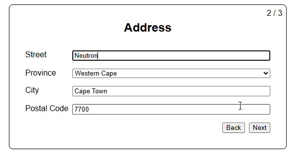

# Multi-Step Form

A small account-creation form built with React, TypeScript, and Vite. It guides users through entering personal details, a South African address, and account credentials.

## Demo



## Getting Started

Install dependencies and start the Vite development server:

```sh
npm install
npm run dev
```

Open the local URL printed by Vite in your terminal.

## Available Scripts

- `npm run dev` starts the development server with hot reloading.
- `npm run build` type-checks the project and creates a production build in `dist/`.
- `npm run preview` serves the production build locally. Run `npm run build` first.
- `npm run lint` runs ESLint across the project.

## Form Flow

1. Enter first name, last name, and age.
2. Enter street, province, city, and a 4-digit South African postal code.
3. Enter an email address and password, then finish.

The inputs use the browser's built-in required-field and email validation. This is a front-end example only: submitting the final step displays a success alert. It does not create an account, send data to a server, or save entries after the page is closed or refreshed.

## Project Structure

- `src/App.tsx` holds the form data and assembles the steps.
- `src/useMultiStepForm.ts` manages the current step and navigation.
- `src/UserForm.tsx`, `src/AddressForm.tsx`, and `src/AccountForm.tsx` implement the individual steps.
- `src/FormWrapper.tsx` provides shared form-step layout.
